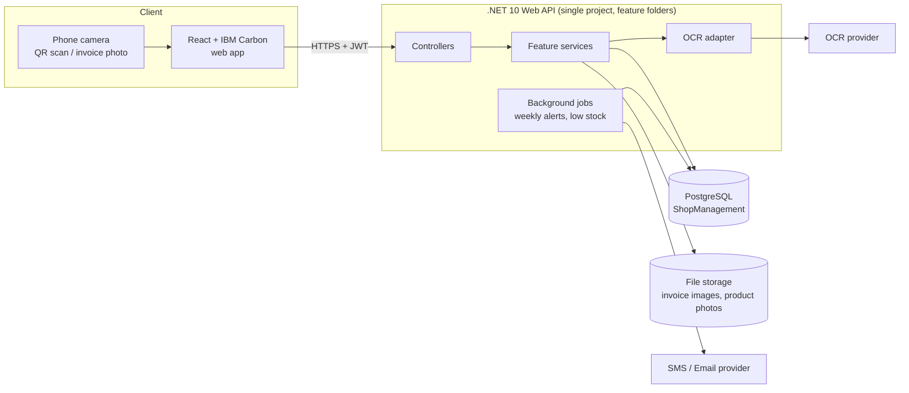
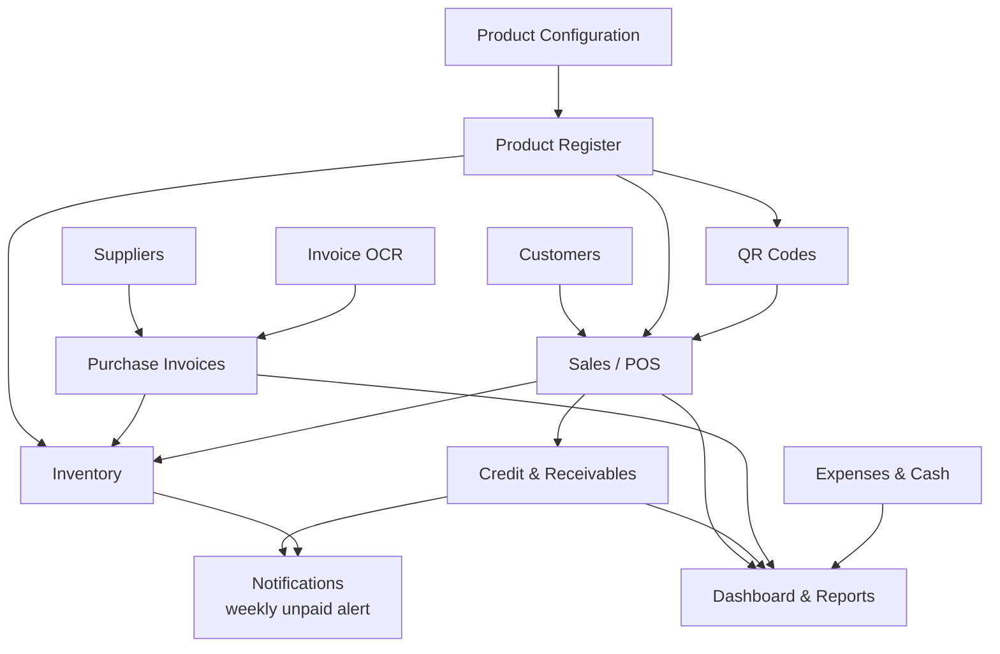

# 02 — System Overview

## 2.1 Architecture



## 2.2 Technology stack

| Layer | Technology | Notes |
|-------|-----------|-------|
| Frontend | React 19, TypeScript, Vite, **IBM Carbon Design System** | Responsive; works on phone for QR scanning and invoice photos |
| Backend | **.NET 10** ASP.NET Core Web API | Single project `backend/ShopManagement.Api.csproj`, organised by `Features/` |
| Database | **PostgreSQL** via EF Core + Npgsql | Schema managed only by EF Core migrations (`backend/Migrations/`) |
| Auth | JWT bearer tokens, ASP.NET Identity password hasher | Already implemented |
| Config | `backend/.env` (git-ignored), `.env.example` template | Already implemented |
| Background jobs | ASP.NET Core `BackgroundService` (or Quartz.NET / Hangfire) | Weekly unpaid alert, low-stock, expiry checks |
| OCR | Pluggable `IInvoiceOcrService` | See [08 — Invoice OCR](08-invoice-ocr.md) |
| QR | `QRCoder` (server) or `qrcode` (client) to generate; browser camera to scan | See [06 — QR Codes](06-qr-codes.md) |
| Files | Local disk in development; S3-compatible storage (e.g. Cloudflare R2) in production | Invoice images, product photos |
| PDF | QuestPDF | Receipts, statements, labels, reports |

## 2.3 Backend folder layout

```
backend/
├── Data/            AppDbContext, entity configurations, seeding
├── db/              Generated SQL exports of migrations (read-only)
├── Domain/          Entities grouped by area
├── Features/
│   ├── Auth/            (exists)
│   ├── Products/        (exists — to be extended)
│   ├── Catalog/         categories, product types, attributes, brands, units
│   ├── QrCodes/
│   ├── Inventory/       stock movements, adjustments
│   ├── Purchasing/      suppliers, purchase invoices, OCR
│   ├── Sales/           POS, receipts, returns
│   ├── Customers/
│   ├── Receivables/     credit sales, repayments, aging
│   ├── Notifications/
│   ├── Dashboard/
│   ├── Reports/
│   ├── Expenses/
│   ├── Users/
│   ├── Settings/
│   └── Shared/
├── Migrations/
└── Program.cs
```

Each feature contains `Controllers/`, `DTOs/`, `Services/` and a `<Feature>Module.cs` that registers its services.

## 2.4 Module map


