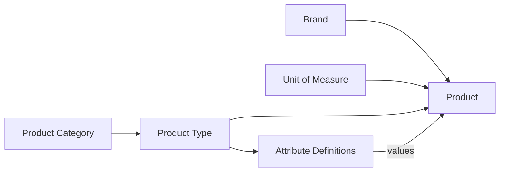

# 04 — Product Configuration

Product configuration is the setup that must exist **before** products are registered. It lets the shop describe very different products (a brake pad and a 4 L can of engine oil) in a structured way.



## 4.1 Product categories

A tree (parent → child) used for browsing, reports and dashboards.

**Example seed data**

```
Lubricants (Caltex)
├── Engine Oil
│   ├── Petrol Engine Oil
│   ├── Diesel Engine Oil
│   └── Motorcycle Oil (4T / 2T)
├── Gear Oil
├── Automatic Transmission Fluid (ATF)
├── Grease
├── Coolant
└── Brake Fluid
Spare Parts
├── Engine Parts
├── Filters (Oil / Air / Fuel / Cabin)
├── Brake System
├── Suspension & Steering
├── Electrical (Batteries, Bulbs, Plugs)
├── Clutch & Transmission
├── Belts & Hoses
└── Body Parts
Accessories
```

| ID | Requirement | Priority |
|----|-------------|----------|
| FR-PC-01 | Create, edit, deactivate categories with name, parent category, description, display order and optional image. | Must |
| FR-PC-02 | Category names are unique within the same parent. | Must |
| FR-PC-03 | A category with products or active children cannot be deleted, only deactivated. | Must |
| FR-PC-04 | Show the category tree with product counts. | Should |

## 4.2 Product types

A product type is a **template** that decides which attributes a product has. Each type belongs to one category.

| Product type | Category | Example attributes |
|--------------|----------|-------------------|
| Engine Oil | Lubricants › Engine Oil | Viscosity grade, API spec, ACEA spec, JASO spec, Base oil, Pack size, Product line (Havoline, Delo, …) |
| Gear Oil | Lubricants › Gear Oil | SAE grade, API GL level, Pack size |
| Grease | Lubricants › Grease | NLGI grade, Thickener, Pack size |
| Oil Filter | Spare Parts › Filters | OEM part no, Thread size, Height, Compatible vehicles |
| Brake Pad | Spare Parts › Brake System | Position (front/rear), OEM part no, Compatible vehicles |
| Battery | Spare Parts › Electrical | Voltage, Ah, CCA, Terminal layout, Warranty months |
| Spark Plug | Spare Parts › Electrical | Thread, Heat range, Gap, Compatible vehicles |

| ID | Requirement | Priority |
|----|-------------|----------|
| FR-PC-10 | Create, edit, deactivate product types with name, category, description. | Must |
| FR-PC-11 | Each product type has its own ordered list of attribute definitions. | Must |
| FR-PC-12 | Flag per type: *tracks expiry/batch* (lubricants), *has warranty* (batteries), *has vehicle compatibility* (parts). | Should |
| FR-PC-13 | Copy an existing type to create a similar one. | Could |

## 4.3 Attribute definitions

| Field | Description |
|-------|-------------|
| Name | e.g. "Viscosity grade" |
| Code | Machine key, e.g. `viscosity_grade` |
| Data type | `Text`, `Number`, `Decimal`, `Boolean`, `Date`, `Select` (one option), `MultiSelect` |
| Options | For Select/MultiSelect, e.g. `0W-20, 5W-30, 10W-40, 15W-40, 20W-50` |
| Unit | Optional, e.g. `L`, `mm`, `Ah` |
| Required | Must be filled when registering a product of this type |
| Searchable | Included in product search and filters |
| Show on QR page | Shown when a QR code is scanned |
| Show on label | Printed on the QR label |
| Display order | Order on forms and detail pages |
| Validation | Min/max for numbers, regex for text (e.g. part numbers) |

| ID | Requirement | Priority |
|----|-------------|----------|
| FR-PC-20 | Add, edit, reorder and deactivate attributes on a product type. | Must |
| FR-PC-21 | Product forms are generated from the type's attribute definitions; required attributes are validated on server. | Must |
| FR-PC-22 | Changing a Select option list does not break existing products; removed options stay readable on old products. | Must |
| FR-PC-23 | Attributes marked *Searchable* can be used as filters on the product list (e.g. all `5W-30` oils). | Should |

## 4.4 Brands

| ID | Requirement | Priority |
|----|-------------|----------|
| FR-PC-30 | Maintain brands (e.g. Caltex, Havoline, Delo, Toyota Genuine, Denso, NGK, Bosch, Exide) with name, country and logo. | Must |
| FR-PC-31 | Mark brands as *Genuine/OEM*, *Aftermarket* or *Lubricant brand* for reporting. | Should |

## 4.5 Units of measure

| ID | Requirement | Priority |
|----|-------------|----------|
| FR-PC-40 | Maintain units: `Piece`, `Set`, `Pair`, `Litre`, `Can`, `Bottle`, `Drum`, `Kg`, `Box`, `Metre`. | Must |
| FR-PC-41 | A product can be bought in one unit and sold in another with a conversion (e.g. buy a **Box of 24**, sell by **Piece**; buy a **210 L Drum** of Lanka Super DS 15W-40, sell loose by the **Litre**). | **Must** (needed for Caltex drum purchases, see FR-OCR-41) |

## 4.6 Vehicle catalogue (for compatibility)

| ID | Requirement | Priority |
|----|-------------|----------|
| FR-PC-50 | Maintain vehicle makes, models, year ranges and engine codes (e.g. Toyota › Axio › 2012–2017 › 1NZ-FE). | Should |
| FR-PC-51 | Products of types with *vehicle compatibility* can be linked to many vehicles. | Should |
| FR-PC-52 | Search products by vehicle ("show all filters for Suzuki Alto 2015"). | Should |
