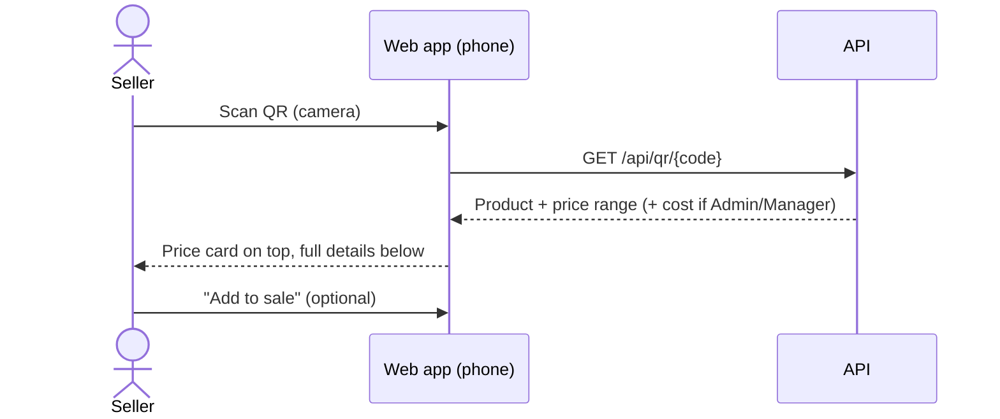

# 06 — QR Codes

Every registered product gets a QR code. Labels are stuck on shelves or products. Scanning the code with a phone or the shop's scanner shows the **price / price range** immediately, and the **full product details** below it.

## 6.1 QR content

The QR code encodes a **URL**, not the price itself, so prices can change without reprinting labels:

```
https://<shop-domain>/p/<qrCode>
e.g. https://shop.example.lk/p/K7X2M9QF
```

- `qrCode` is a short, random, unique code stored on the product (not the database ID, so codes cannot be guessed in sequence).
- Any phone camera can open it. Inside the app, the built-in scanner reads the same code.

| ID | Requirement | Priority |
|----|-------------|----------|
| FR-QR-01 | Generate a unique random 8-character QR code when a product is registered. | Must |
| FR-QR-02 | Regenerate a product's QR code (old one stops working) — Admin/Manager only. | Should |
| FR-QR-03 | QR images available as PNG and SVG via the API. | Must |

## 6.2 Labels

| ID | Requirement | Priority |
|----|-------------|----------|
| FR-QR-10 | Print a label with: QR code, product name, SKU, key attributes marked *Show on label* (e.g. `5W-30 · 4 L`), and optionally the selling price. | Must |
| FR-QR-11 | Label sizes: 38×25 mm, 50×30 mm (thermal label printers), and A4 sheet (e.g. 3×8 labels). | Must |
| FR-QR-12 | Bulk print: selected products, a category, or all products received on a purchase invoice (with quantity = received quantity). | Should |
| FR-QR-13 | Labels are generated as PDF for printing. | Must |

## 6.3 Scan flow



### What the scan screen shows

**Top: price card** (large, readable at a glance)

| Shown to | Content |
|----------|---------|
| Everyone | Product name, photo, **Selling price** |
| Seller and above | **Price range**: Min – Max (e.g. `LKR 4,800 – 5,200`), Garage price if any |
| Admin/Manager | Cost price and margin % |
| Seller and above | Stock on hand and shelf location; "Out of stock" badge |

**Below: full details**

- Brand, SKU, barcode, category, product type
- All attribute values (e.g. Viscosity, API spec, Pack size)
- OEM and alternative part numbers
- Compatible vehicles
- Warranty
- Batches with expiry dates (lubricants)
- Last sold date and price
- Actions: **Add to sale**, **Print label**, **Edit** (Admin/Manager), **Stock movements**

| ID | Requirement | Priority |
|----|-------------|----------|
| FR-QR-20 | In-app scanner uses the device camera (rear camera by default) and also accepts USB/Bluetooth scanners that type the code. | Must |
| FR-QR-21 | For a logged-in user, scanning a QR code opens the scan screen in under 2 seconds on 4G. | Must |
| FR-QR-22 | The scan screen shows price card then full details as described above, filtered by role. | Must |
| FR-QR-23 | "Add to sale" puts the product in the current POS cart ([09](09-sales-and-pos.md)). | Must |
| FR-QR-24 | Inactive product: show the details with an *Inactive — cannot be sold* banner. | Must |
| FR-QR-25 | Unknown code: show "Product not found" with a search box. | Must |
| FR-QR-26 | Scanning a manufacturer barcode (EAN) finds the product too. | Should |

## 6.4 Public view (optional)

When a customer scans a label with their own phone and is **not logged in**:

| ID | Requirement | Priority |
|----|-------------|----------|
| FR-QR-30 | Setting *Public QR page* (off by default). When on, shows name, photo, brand, selling price, public attributes and shop contact — **never** min price, cost or stock. | Could |
| FR-QR-31 | When off, unauthenticated scans go to the login page and return to the product after login. | Must |
| FR-QR-32 | Public endpoint is rate-limited. | Must |
