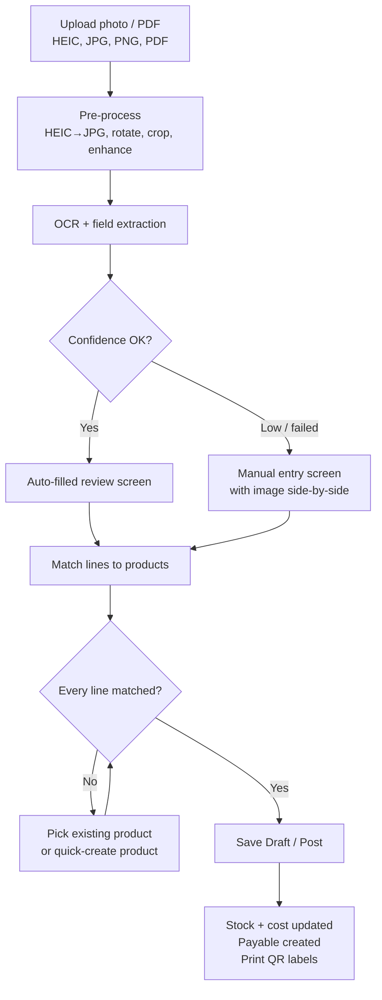

# 08 — Invoice OCR

The seller/manager takes a **photo of a supplier invoice** (or uploads a scan/PDF). The system reads it with OCR and **fills the purchase invoice automatically**. The user then reviews, corrects anything wrong, and posts. If OCR is unavailable or the photo is poor, the same screen works as a **manual entry** form that asks only for the necessary fields.

> **Reference invoice:** `IMG_8334.HEIC` — a Caltex distributor invoice from **S.B.D. Enterprises** (Caltex Regional Ware House, Panadura) to **Jayashan Oil Mart**. Its layout, fields and pitfalls are documented in [8.4](#84-fields) and [8.9](#89-reference-invoice-sbd-enterprises--caltex).

## 8.1 Flow



## 8.2 Upload

| ID | Requirement | Priority |
|----|-------------|----------|
| FR-OCR-01 | Upload from phone camera (direct capture) or file: **HEIC/HEIF, JPG, PNG, PDF**; max 15 MB; multi-page invoices as several photos or one PDF. | Must |
| FR-OCR-02 | HEIC images (iPhone default) are converted to JPG on upload so every browser can display them. | Must |
| FR-OCR-03 | Auto-rotate (EXIF), deskew, crop to the paper, and increase contrast before OCR. | Should |
| FR-OCR-04 | The original file is stored and linked to the purchase invoice. | Must |
| FR-OCR-05 | The same file (hash) uploaded twice shows "This invoice image was already uploaded" with a link. | Should |

## 8.3 Extraction

| ID | Requirement | Priority |
|----|-------------|----------|
| FR-OCR-10 | Extract header fields and line items listed in 8.4 into a structured result with a **confidence score per field**. | Must |
| FR-OCR-11 | Processing runs in the background; the UI shows progress and opens the review screen when done (target < 20 s per page). | Must |
| FR-OCR-12 | Supplier detected by name/phone/VAT number on the invoice; matched to existing supplier or offered as new supplier. | Must |
| FR-OCR-13 | Numbers normalised: `1,250.00` → 1250.00, `Rs.`/`LKR` stripped, dates in `dd/MM/yyyy`, `dd-MM-yy`, `dd.MM.yyyy` parsed. | Must |
| FR-OCR-14 | Cross-checks: `qty × unit price − discount ≈ line total`; `Σ lines ≈ subtotal`; `subtotal − discount + tax ≈ grand total`. Failing checks are highlighted. | Must |
| FR-OCR-15 | OCR provider is pluggable behind `IInvoiceOcrService` (see 8.7). | Must |
| FR-OCR-16 | Cross-checks allow a tolerance of **± LKR 1.00** per line and on totals (the reference invoice prints Rate/Pack `291,000.01` vs Net Value `291,000.00`). | Must |
| FR-OCR-17 | The amount in words is parsed and compared to the grand total; a mismatch is highlighted. | Should |
| FR-OCR-18 | Handwriting, signatures, stamps and Sinhala/Tamil stamp text are ignored for field values. | Must |
| FR-OCR-19 | Payment-mode checkboxes are read; if none is ticked the payment type defaults to **Credit** and the due date is taken from the invoice. | Should |

## 8.4 Fields

Only fields marked **Required** must be filled to save; everything else is optional. The *Label on reference invoice* column is what appears on the S.B.D. Enterprises / Caltex invoice (see 8.9).

**Header**

| Field | Required | Label on reference invoice | Example | Notes |
|-------|:--------:|----------------------------|---------|-------|
| Supplier | ✅ | Letterhead + "Supplier's Name" | S.B.D. Enterprises | Match by name, phone (`038-22 82 899`, `0706623800`) or email |
| Supplier invoice no. | ✅ | Invoice No | `INPAN015094` | Unique per supplier |
| Invoice date | ✅ | Date of Invoice | `11/07/2026` → **7 Nov 2026** | Date format per supplier — see FR-OCR-40 |
| Grand total | ✅ | Total | `291,000.00` | Cross-check with amount in words |
| Payment type | ✅ | Mode of Payment checkboxes | none ticked → **Credit** | Default Credit when no box is ticked |
| Due date | | Invoice Due Date | `November 07, 2026` | Prefer printed due date over supplier terms |
| Date of supply / received date | | Date of Supply | `11/07/2026` | Defaults to invoice date |
| Supplier order no. | | Order No | `SOPAN003D02007579` | |
| Our customer code at supplier | | Customer Code | `PAN0000000027` | Used to confirm the invoice is for this shop |
| Purchaser name | | Purchaser's Name | JAYASHAN OIL MART … | Warn if it does not match the shop name |
| Place of supply | | Place of Supply | Central | |
| Mode of delivery | | Mode of Delivery | Distributor Delivery | |
| Subtotal | | Sub Total | `291,000.00` | |
| Total litres | | Sub Total (Qty. Litres column) | `210.00` | Lubricant invoices only |
| Amount in words | | Total Amount in words | TWO HUNDRED NINETY ONE THOUSAND ONLY | Validation only, not stored as money |
| Discount / VAT / other charges | | — (not on this invoice) | | Other suppliers |
| Supplier VAT/TIN | | — | | Other suppliers |

**Line items**

| Field | Required | Label on reference invoice | Example | Notes |
|-------|:--------:|----------------------------|---------|-------|
| Product (matched) | ✅ | — | Lanka Super DS SAE 15W-40 – 210 L Drum | Chosen from matching (FR-OCR-22) |
| Quantity (packs) | ✅ | Qty. Packs | `1` | |
| Unit cost (per pack) | ✅ | Rate/Pack | `291,000.01` | |
| Item no. | | Item No. | `1` | Line order only |
| Supplier item code | | Item code | `504300DBE_03` | **Primary key for supplier item mapping** |
| Description (as printed) | | Item Description | `Lanka Super DS SAE 15W-40 (210LM)` | |
| Pack unit | | (code under description) | `DR` | Map codes: `DR` Drum, `CN`/`CAN` Can, `BT` Bottle, `PL` Pail, `CT`/`CTN` Carton |
| Quantity (litres) | | Qty. Litres | `210.00` | Gives litres per pack (210 ÷ 1) |
| Line total | | Net Value Rs. | `291,000.00` | |
| Discount | | — | | Other suppliers |
| Batch / expiry | Only if product tracks expiry | — | | Not printed on this invoice; enter manually if needed |

**Ignored on purpose:** handwritten notes and dates, signatures, rubber stamps ("ISSUED", "Customer's Copy"), Sinhala delivery-stamp block, "Approved by"/"Checked by" boxes, footer terms.


## 8.5 Review screen

Image on the left (zoomable), form on the right. Clicking a field highlights where it was read on the image.

| ID | Requirement | Priority |
|----|-------------|----------|
| FR-OCR-20 | Fields with low confidence (< 80%) or failed cross-checks are highlighted amber; missing required fields red. | Must |
| FR-OCR-21 | Every field is editable; lines can be added, removed, split or merged. | Must |
| FR-OCR-22 | Line matching order: (1) supplier item mapping (FR-INV-18), (2) barcode/OEM part number, (3) SKU, (4) fuzzy name match with suggestions. | Must |
| FR-OCR-23 | Unmatched line: **Pick product** (search) or **Quick-create product** with name, type, unit, cost and selling price pre-filled; product saved as *Draft* (FR-PR-18). | Must |
| FR-OCR-24 | Confirmed matches are saved to supplier item mapping so the next invoice auto-matches. | Must |
| FR-OCR-25 | Save as Draft (finish later) or Post (see FR-INV-10). | Must |
| FR-OCR-26 | Record what OCR read vs. what the user saved, to measure accuracy per supplier. | Should |

## 8.6 Manual entry (alternative)

| ID | Requirement | Priority |
|----|-------------|----------|
| FR-OCR-30 | "Enter manually" is always available, with or without an image. | Must |
| FR-OCR-31 | The manual form shows **only required fields** by default (supplier, invoice no, date, payment type, grand total, and per line: product, qty, unit cost); "More fields" expands the rest. | Must |
| FR-OCR-32 | Fast line entry: scan product QR/barcode or type part number → qty → cost → Enter adds next line. | Must |
| FR-OCR-33 | If OCR fails or the provider is down, the screen falls back to manual entry with the image still visible. | Must |

## 8.7 OCR provider options

| Option | Pros | Cons |
|--------|------|------|
| **Vision LLM** (send image, ask for JSON matching 8.4) | Best at messy/handwritten Sri Lankan invoices, reads tables well, returns structured data directly | Per-call cost; needs internet; needs schema validation |
| **Azure AI Document Intelligence** (prebuilt invoice model) | Purpose-built invoice fields, bounding boxes, confidence | Cost; weaker on handwriting/local layouts |
| **Google Document AI** (invoice parser) | Similar to Azure | Cost; setup |
| **Tesseract** (local, free) | No cost, offline | Raw text only — needs own parsing; poor on photos/handwriting |

**Recommendation:** implement `IInvoiceOcrService` with a **Vision LLM provider first**, validate its JSON against the 8.4 schema, and keep **Tesseract** as an offline fallback. API keys go in `backend/.env`.

```csharp
public interface IInvoiceOcrService
{
    Task<OcrInvoiceResult> ExtractAsync(Stream image, string contentType, CancellationToken ct);
}
```

## 8.8 Privacy & cost

- **NFR**: Invoice images are stored privately (signed URLs only), never publicly listed.
- Show OCR usage (pages processed this month) to Admin; configurable monthly limit.

## 8.9 Reference invoice: S.B.D. Enterprises — Caltex

The shop's main lubricant supplier. Layout of `IMG_8334.HEIC`:

```
┌───────────────────────── yellow band ─────────────────────────┐
│ Chevron / Texaco / Caltex logos   S.B.D. ENTERPRISES.          │ Invoice
│                                   CALTEX REGIONAL WARE HOUSE - │ Customer's Copy 1
│                                   PANADURA, tel/fax/email       │
└────────────────────────────────────────────────────────────────┘
┌ Date of Invoice ┐                 ┌ Invoice No ┐
┌ Supplier's Name / Address / Tel ┐ ┌ Customer Code / Purchaser's Name / Address / Tel ┐
┌ Date of Supply ┐                  ┌ Place of Supply ┐
┌ Order No · Invoice Due Date · Our Ref. No · Mode of Delivery │ Delivery to ┐
Item No │ Item code │ Item Description / Qty. Packs / Qty. Litres │ Rate/Pack │ Net Value Rs.
   1    │504300DBE_03│ Lanka Super DS SAE 15W-40 (210LM)          │291,000.01 │ 291,000.00
        │            │ 1   DR   210.00                             │           │
Sub Total:                                  210.00                              291,000.00
Total:                                                                          291,000.00
Total Amount in words: TWO HUNDRED NINETY ONE THOUSAND ONLY
Checked by / Approved by │ Mode of Payment ☐ │ Customer Signature │ Delivery Date Stamp (Sinhala)
```

**Expected extraction**

```json
{
  "supplier": { "name": "S.B.D. Enterprises", "phone": "0706623800", "email": "sbdcaltex@gmail.com" },
  "invoiceNo": "INPAN015094",
  "invoiceDate": "2026-11-07",
  "supplyDate": "2026-11-07",
  "dueDate": "2026-11-07",
  "orderNo": "SOPAN003D02007579",
  "ourCustomerCode": "PAN0000000027",
  "purchaserName": "JAYASHAN OIL MART AND CONSTRUC…",
  "placeOfSupply": "Central",
  "modeOfDelivery": "Distributor Delivery",
  "paymentType": "Credit",
  "lines": [
    {
      "itemNo": 1,
      "supplierItemCode": "504300DBE_03",
      "description": "Lanka Super DS SAE 15W-40 (210LM)",
      "packQty": 1,
      "packUnit": "DR",
      "litres": 210.00,
      "ratePerPack": 291000.01,
      "lineTotal": 291000.00
    }
  ],
  "subtotal": 291000.00,
  "totalLitres": 210.00,
  "grandTotal": 291000.00,
  "amountInWords": "TWO HUNDRED NINETY ONE THOUSAND ONLY",
  "checks": { "lineMath": "ok (diff 0.01)", "totals": "ok", "amountInWords": "ok", "purchaserIsShop": "ok" }
}
```

### Pitfalls found on this invoice

| Pitfall | Requirement |
|---------|-------------|
| **Ambiguous date.** "11/07/2026" is month-first: the same invoice prints "Invoice Due Date: November 07, 2026" and was checked by hand on "9/11/26". Read as day-first it would be 11 July. | FR-OCR-40 |
| Rate/Pack 291,000.01 vs Net Value 291,000.00 | FR-OCR-16 |
| Bought as **1 Drum (DR) = 210 L**, but loose oil is sold by the litre | FR-OCR-41 |
| Item description contains the pack size code `(210LM)` | FR-OCR-41 |
| Photo is skewed, paper is creased, binder clip and punch holes on the left edge | FR-OCR-03 |
| Handwritten date/signature and "ISSUED" stamp overlap printed text | FR-OCR-18 |
| No payment box ticked | FR-OCR-19 |

| ID | Requirement | Priority |
|----|-------------|----------|
| FR-OCR-40 | Each supplier has a **date format** setting (`MM/dd/yyyy` for S.B.D. Enterprises, `dd/MM/yyyy` default). When a numeric date is ambiguous (both parts ≤ 12), the system checks it against other dates on the invoice (written-out due date, supply date) and today's date, and highlights the field if it still cannot decide. | Must |
| FR-OCR-41 | Lubricant lines: read pack quantity, pack unit and litres. When the product is sold by the litre, stock is received in **litres** (210) and cost per litre = rate ÷ litres per pack (291,000 ÷ 210 = **LKR 1,385.71/L**). When sold by the pack (e.g. 4 L can), stock is received in packs. The conversion is stored in supplier item mapping. | Must |
| FR-OCR-42 | Supplier templates: the first invoice from a supplier saves which labels map to which fields; later invoices from the same supplier use it as a hint to improve accuracy. | Should |
| FR-OCR-43 | If **Customer Code / Purchaser's Name** does not match the shop (Settings → shop name and supplier account codes), warn "This invoice may not be for this shop". | Should |

