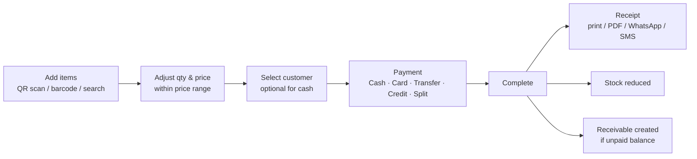

# 09 — Sales & POS

## 9.1 Making a sale

| ID | Requirement | Priority |
|----|-------------|----------|
| FR-SL-01 | Add items by QR scan, barcode, SKU, part number or name search. | Must |
| FR-SL-02 | Default unit price = selling price (or garage price for Garage customers). | Must |
| FR-SL-03 | Seller can change the price only **within the price range** (min ≤ price ≤ max). Below minimum requires Manager/Admin approval (PIN or remote approve); the approver is recorded. | Must |
| FR-SL-04 | Line discount and bill discount (amount or %); total discount cannot take any line below its minimum price without approval. | Must |
| FR-SL-05 | Shows stock while adding; blocks selling more than available unless negative stock is allowed. | Must |
| FR-SL-06 | Customer is optional for fully paid sales, **required** for credit or partially paid sales. | Must |
| FR-SL-07 | Vehicle number can be recorded on the sale (useful for warranty and service history). | Should |
| FR-SL-08 | Hold/park a bill and resume later (several open carts). | Should |
| FR-SL-09 | Sale numbers are sequential per year: `INV-2026-000123`. | Must |

## 9.2 Payments

| Method | Details captured |
|--------|-----------------|
| Cash | Amount tendered, change |
| Card | Last 4 digits / reference (optional) |
| Bank transfer | Reference, bank |
| Cheque | Cheque no, bank, cheque date (post-dated allowed) |
| **Credit** | No payment now; full amount becomes receivable |
| **Split** | Any combination, e.g. LKR 5,000 cash + rest on credit |

| ID | Requirement | Priority |
|----|-------------|----------|
| FR-SL-10 | Support all payment methods above, including split payments. | Must |
| FR-SL-11 | Any unpaid balance becomes a **credit sale** on the customer's account ([11](11-credit-sales-and-receivables.md)). | Must |
| FR-SL-12 | Credit is blocked if it would exceed the customer's credit limit, or the customer has overdue balance and the setting *block when overdue* is on; Manager can override. | Must |
| FR-SL-13 | Post-dated cheques are tracked until cleared; a bounced cheque re-opens the receivable. | Should |

## 9.3 Receipts

| ID | Requirement | Priority |
|----|-------------|----------|
| FR-SL-20 | Print receipt on 80 mm thermal printer or A4/A5 invoice. | Must |
| FR-SL-21 | Receipt shows shop details, sale number, date/time, seller, customer, items, discounts, payments, **balance due** and customer's **total outstanding** for credit customers. | Must |
| FR-SL-22 | Share receipt as PDF via WhatsApp / SMS link / email. | Should |
| FR-SL-23 | Reprint any past receipt. | Must |

## 9.4 Returns & voids

| ID | Requirement | Priority |
|----|-------------|----------|
| FR-SL-30 | Return items from a past sale (full or partial); refund cash, or credit the customer's account. Stock is returned (or marked damaged). | Must |
| FR-SL-31 | Void a sale (same day, not yet closed) by Manager/Admin with reason; reverses stock and payments. | Must |
| FR-SL-32 | Warranty claim: look up sale by customer/vehicle/date, check warranty period, record claim and outcome. | Could |

## 9.5 Quotations

| ID | Requirement | Priority |
|----|-------------|----------|
| FR-SL-40 | Create a quotation (no stock change), print/share, convert to sale later. Valid-until date. | Could |
